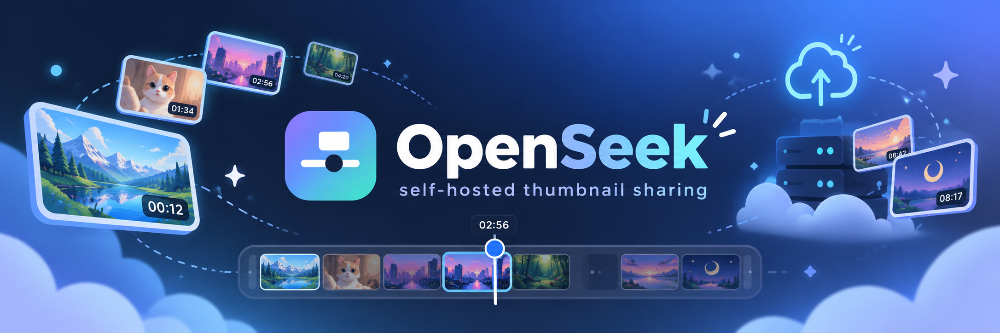
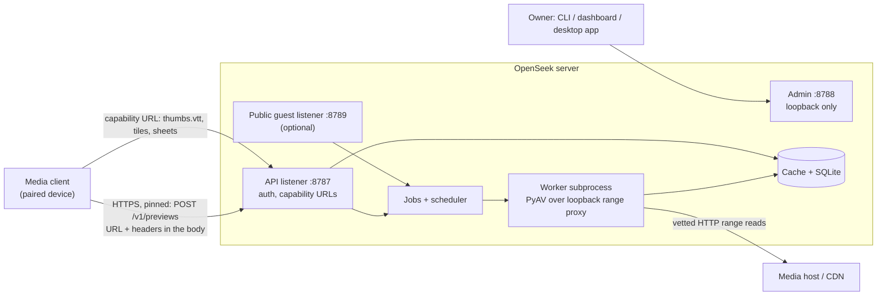
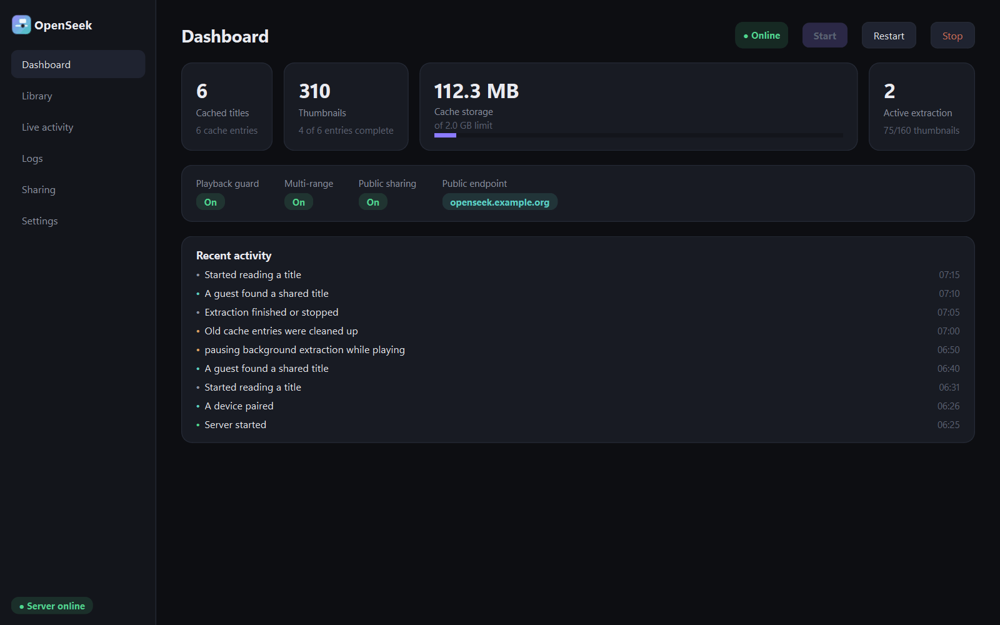
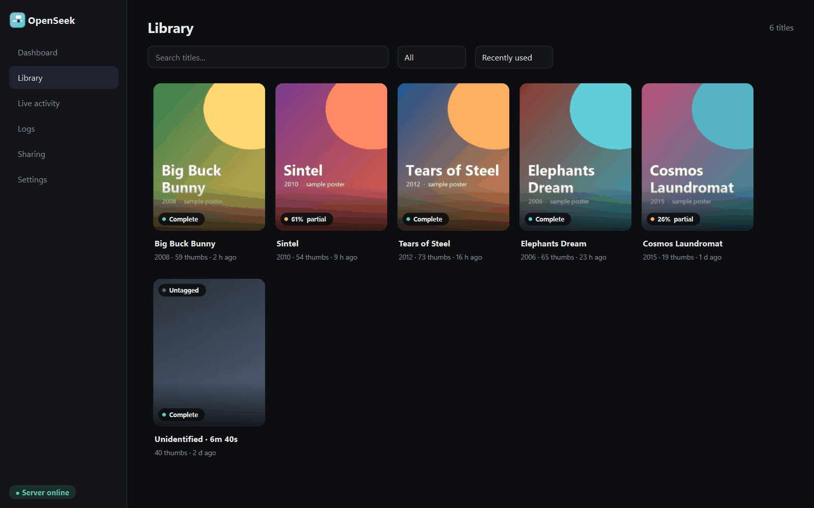
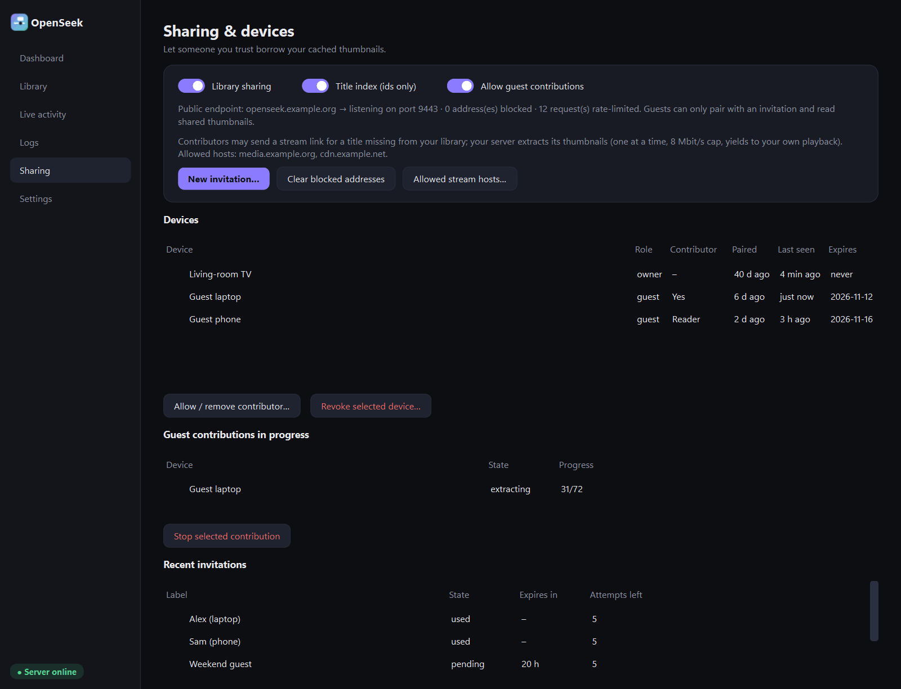

# OpenSeek


OpenSeek is a free, self-hosted service that generates seek-preview thumbnails (a WebVTT file plus JPEG
tiles and tile sheets) for video playback. A media client sends the HTTP(S) URL it is playing; OpenSeek reads
only small parts of the file with HTTP range requests, decodes frames around the scrub position, and serves the
previews through short-lived capability URLs.

Status: version 0.1.0, an initial experimental release. See [Status and limitations](#status-and-limitations).
License: [AGPL-3.0-or-later](LICENSE).

## Features

* On-demand extraction: tiles near the scrub position first (latest request wins), then the playhead window,
  then a progressive overview (60 s, 30 s, 10 s grid), at a bounded background rate.
* Bounded reads: preflight requires `206 Partial Content`; per-job byte budget; optional multi-range
  (multipart/byteranges) prefetch; optional global request pacing.
* Playback guard (optional): pauses background extraction when the client reports a rebuffer, telemetry goes
  stale, or the source stalls, so extraction does not compete with the owner's own streaming.
* Thumbnail cache and library: tiles are stored individually (320x180 JPEG), sheets (3200x1800) are composed on demand;
  LRU-by-bytes eviction and retention. An opt-in title index (IMDb/TMDB ids, season, episode) lets another release of the
  same title reuse cached thumbnails, flagged as approximate, with per-device offsets and rejections.
* Device pairing (OSP1): an 8-symbol code, PBKDF2 key derivation bound to the server's certificate pin, mutual proofs.
  Self-signed ECDSA P-256 certificate; clients pin the SPKI.
* Optional public guest listener (off by default): invite-only, deny-by-default, per-address rate limits and blocks.
* Contributor Mode (off by default): trusted guests may contribute thumbnails from their own link, under an
  allowlisted-host, https-only, SSRF-safe policy and a work-conserving scheduler that yields to the owner.
* Desktop app (`desktop/`, PySide6, Windows): dashboard, poster library, live activity, logs, sharing, settings.
  See [docs/DESKTOP.md](docs/DESKTOP.md).

## Architecture



More detail: [docs/ARCHITECTURE.md](docs/ARCHITECTURE.md).

## Quick start

Requirements: Python 3.12 or newer. FFmpeg libraries come with the `av` (PyAV) wheel; no separate ffmpeg install is needed to run the server (ffmpeg is only used to generate test fixtures).

Windows (PowerShell):

```powershell
cd backend
python -m venv .venv
.venv\Scripts\pip install -r requirements.txt -c requirements-lock.txt
$env:OPENSEEK_DATA_DIR = "$env:LOCALAPPDATA\OpenSeek\data"
.venv\Scripts\python -m openseek serve
```

Linux:

```sh
cd backend
python3 -m venv .venv && .venv/bin/pip install -r requirements.txt -c requirements-lock.txt
OPENSEEK_DATA_DIR=$HOME/.local/share/openseek .venv/bin/python -m openseek serve
```

Docker (see [docs/INSTALL.md](docs/INSTALL.md); the image has not been built by the maintainers' tooling yet):

```sh
docker compose up -d
docker compose exec openseek python -m openseek pair
```

In another terminal on the same machine run `python -m openseek pair`. It opens a 10-minute pairing window and prints a
one-time code and the server's certificate pin. Enter the code, the server address and (if your client asks) the pin in your client.
`python -m openseek devices` lists paired devices and `python -m openseek revoke <device_id>` removes one.

## Configuration

All settings are environment variables read at start-up. Invalid values stop the server with a configuration error.

| Variable | Default | Meaning |
|---|---|---|
| `OPENSEEK_DATA_DIR` | `data` | Database, secret key, TLS identity, cache |
| `OPENSEEK_HOST` / `OPENSEEK_PORT` | `0.0.0.0` / `8787` | HTTPS API listener |
| `OPENSEEK_ADMIN_PORT` | `8788` | Admin listener, always bound to 127.0.0.1; every call except the dashboard page needs the admin secret |
| `OPENSEEK_ADMIN_TOKEN` | random, in `<data>/admin.token` | Optional explicit admin secret (at least 16 characters). Normally leave unset |
| `OPENSEEK_PUBLIC_PORT` | `0` (off) | Internet-facing guest listener; must differ from the other ports |
| `OPENSEEK_PUBLIC_BIND` | `0.0.0.0` | Bind address of the guest listener |
| `OPENSEEK_PUBLIC_HOST` | empty | `name.example.org:443`, advertised in invitations and capability URLs |
| `OPENSEEK_CACHE_MAX_BYTES` | 2 GiB | Cache cap (LRU eviction, minimum 16 MiB) |
| `OPENSEEK_RETENTION_DAYS` | `30` | Drop titles unused for this long |
| `OPENSEEK_BG_MBPS` | `8` | Background (overview) byte-rate cap, Mbit/s |
| `OPENSEEK_JOB_BYTES` | 4 GiB | Per-job upstream byte budget (minimum 1 MiB) |
| `OPENSEEK_TOLERANCE_S` | `5` | Preview tolerance, 0 < t <= 5 |
| `OPENSEEK_PREGEN` | `full` | `off`, `overview` or `full` background generation |
| `OPENSEEK_MAX_ACTIVE_SOURCES` | `2` | Sources with a live worker; beyond this `429 busy` |
| `OPENSEEK_WORKERS_PER_SOURCE` | `1` | Parallel extraction workers per source (1 to 4) |
| `OPENSEEK_MAX_JOBS_PER_DEVICE` | `1` | A device's older active job is stopped when it starts another |
| `OPENSEEK_IDLE_TIMEOUT_S` | `600` | Worker stopped after this long without client activity |
| `OPENSEEK_FRAME_TIMEOUT_S` | `30` | Hard per-frame timeout |
| `OPENSEEK_CREATE_WAIT_S` | `4` | How long `POST /v1/previews` waits for the preflight |
| `OPENSEEK_ALLOWED_PORTS` | `80,443,8080,8443` | Allowed upstream ports |
| `OPENSEEK_ALLOW_HTTP_SOURCES` | `1` | Allow plain `http://` sources (public addresses only) |
| `OPENSEEK_ALLOW_PUBLIC_CLIENTS` | `0` | Accept non-private client IPs on the owner API. Needs `OPENSEEK_ALLOW_PUBLIC_CLIENTS_ACK=owner-api-is-public` as well; prefer the guest listener |
| `OPENSEEK_PUBLISHED_ON` | none | Containers only (set by the compose file): the host address the port is published on. The server refuses to start unless it is loopback or a private LAN address |
| `OPENSEEK_ALLOW_SHARED_DATA_DIR` | `0` | Windows: start even if other local users can write to the data directory (not recommended) |
| `OPENSEEK_UPSTREAM_RPS` | `0` (off) | Global upstream request pacing (0 to 100) |
| `OPENSEEK_MULTIRANGE_PREFETCH` / `OPENSEEK_MULTIRANGE_BATCH` | `0` / `8` | Experimental multi-range prefetch; windows per request (2 to 16) |
| `OPENSEEK_PLAYBACK_GUARD` | `0` | Pause background extraction on rebuffer, stale telemetry or CDN stall |
| `OPENSEEK_GUARD_STALL_S` | `6` | Stall threshold for the guard (1 to 60) |
| `OPENSEEK_CONTRIB_MBPS` | `16` | Extra byte cap for contributions while the owner is busy |
| `OPENSEEK_CONTRIB_MAX_SOURCES` | `1` | Concurrent contributed sources (1 to 4) |
| `OPENSEEK_CONTRIB_HOSTS` | common debrid/CDN hosts | Default contributor host allowlist (editable by the owner) |
| `OPENSEEK_P2_PAUSE_S`, `OPENSEEK_P1_INTERLEAVE`, `OPENSEEK_HIERARCHICAL`, `OPENSEEK_NEAREST_KEYFRAME` | see `config.py` | Scheduler experiments |
| `OPENSEEK_ALT_*` | off | Experimental alternative low-resolution source negotiation (`OPENSEEK_ALT_SOURCE` and related); see `backend/openseek/config.py` |
| `OPENSEEK_CAPTURE_SOURCE_FILE` | empty | Diagnostics: writes the resolved source link to a file. Leave unset |
| `OPENSEEK_LOG_LEVEL` | `INFO` | Log level |

There is deliberately no variable that relaxes the outbound destination policy. The authoritative list is
`backend/openseek/config.py`.

## Desktop app



OpenSeek Desktop (PySide6) manages a running server: dashboard, poster library, live activity, logs, sharing and settings.
See [docs/DESKTOP.md](docs/DESKTOP.md) for usage, building the .exe and the offline demo mode (`python desktop/run_openseek.py --demo`).
Screenshots show synthetic sample data only (Blender open movies, CC BY).

| Library | Sharing |
|---|---|
|  |  |

## Security summary

* The API is HTTPS only; certificates are self-signed and clients pin the public key. No plain-HTTP API.
* Every route except health and pairing needs a device token; data URLs use expiring HMAC capabilities.
* Outbound fetching is SSRF-hardened: destinations are resolved once, every address must be public, redirects are followed
  by OpenSeek (max 5, re-vetted), and the decoder only reads from a loopback range proxy.
* Stream URLs and headers are kept in memory and, by default, not written to disk or logs (tests check this); logs redact URLs, tokens and codes.
  The opt-in diagnostic `OPENSEEK_CAPTURE_SOURCE_FILE` is the one exception, so leave it unset.
* The admin interface is loopback only with Host/Origin checks and a CSRF header.
* The owner API refuses non-private client addresses unless you opt in. The public guest listener is off by default.

Details: [docs/SECURITY-MODEL.md](docs/SECURITY-MODEL.md). To report a vulnerability see [SECURITY.md](SECURITY.md).

## Responsible use

OpenSeek is free and self-hosted. The maintainer does not operate anyone's server, does not host thumbnail libraries,
provides no movie downloads and runs no central content-sharing service. Each server owner controls their own installation and
authorised devices. You must hold the rights, permissions or applicable legal exceptions needed to generate and share thumbnails
from the media you point OpenSeek at. This notice does not remove anyone's legal responsibility and is not legal advice.
See [docs/RESPONSIBLE-USE.md](docs/RESPONSIBLE-USE.md).

## Documentation

* [docs/INSTALL.md](docs/INSTALL.md): Windows, Linux, Docker, exposing the guest listener
* [docs/ARCHITECTURE.md](docs/ARCHITECTURE.md)
* [docs/SECURITY-MODEL.md](docs/SECURITY-MODEL.md)
* [docs/api/CONTRACT-v1.md](docs/api/CONTRACT-v1.md) and `backend/openapi.json`: the HTTP API, for client authors
* [docs/DESKTOP.md](docs/DESKTOP.md): the Windows desktop app
* [docs/RESPONSIBLE-USE.md](docs/RESPONSIBLE-USE.md), [docs/LICENSE-OPTIONS.md](docs/LICENSE-OPTIONS.md)
* [CONTRIBUTING.md](CONTRIBUTING.md), [SECURITY.md](SECURITY.md), [CHANGELOG.md](CHANGELOG.md), [CODE_OF_CONDUCT.md](CODE_OF_CONDUCT.md)

A client for a Nuvio Legacy fork exists as a separate project maintained elsewhere. Any client can use the documented HTTP API.

## License

OpenSeek is free software, licensed under the **GNU Affero General Public License, version 3 or (at your option) any later version** (AGPL-3.0-or-later);
see [LICENSE](LICENSE). Copyright (C) 2026 the OpenSeek authors. You may use, study, change and share it. If you run a modified version for other people
over a network, the AGPL (section 13) requires you to offer those users the corresponding source.

OpenSeek's Python dependencies are permissively licensed, except that the `av` (PyAV) wheels bundle FFmpeg libraries built with GPL components; they are
downloaded onto your machine when you install the requirements and are not part of this repository. For that reason **this project publishes source code and a
Dockerfile only, not prebuilt Docker images**; build the image yourself with `docker compose up -d --build`. Details: [docs/LICENSE-OPTIONS.md](docs/LICENSE-OPTIONS.md).

## Status and limitations

* Initial experimental release. It has an automated test suite and was put through an adversarial pre-release review (see
  [docs/security/PRE-RELEASE-REVIEW.md](docs/security/PRE-RELEASE-REVIEW.md), including what could not be tested), but it has **not** been independently
  audited or security-certified. It is built for a trusted home network: keep the owner API off the internet and use the guest listener for remote devices.
  Behaviour against every real-world CDN, release type or client has not been verified.
* MP4 files without a usable index (fragmented, no `mfra`) are not detected up front; the byte budget bounds the cost.
* Worker memory is bounded only by container or OS limits; extraction runs in a separate process but is not OS-sandboxed.
* Pairing is password-authenticated key confirmation, not a PAKE.
* Dependencies are pinned by version (`backend/requirements-lock.txt`), not by hash; `pip-audit` is not wired up.
* No prebuilt Docker images are published (see License); build from the Dockerfile.
* The desktop app is Windows only. The server is developed on Windows and tested in Linux containers.
* Access logs record client IPs and request times and are not rotated by OpenSeek.
