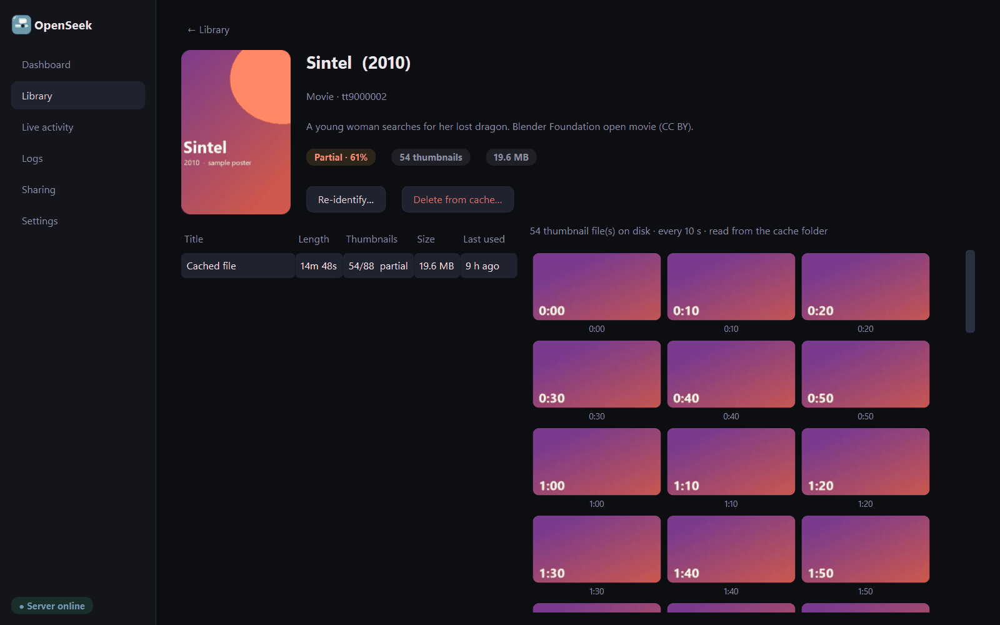
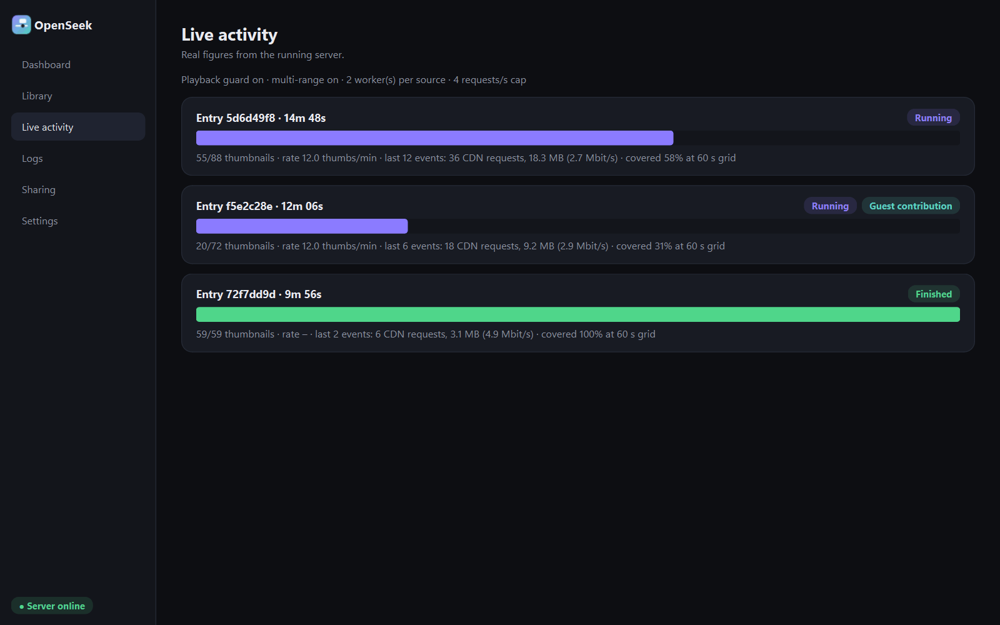
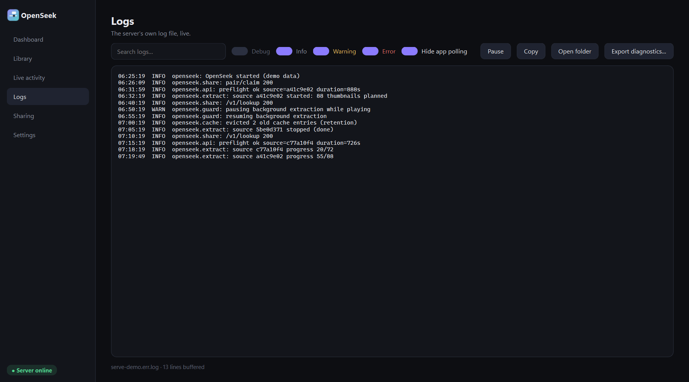
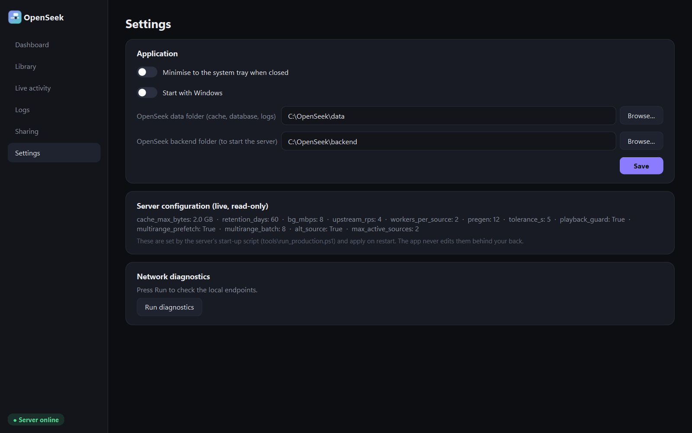

# OpenSeek Desktop

OpenSeek Desktop is a native Windows app (PySide6) for managing an existing OpenSeek server: dashboard, poster library,
live extraction activity, logs, sharing and devices, and settings. It attaches to the server that is already running (it never
starts a second one on a busy port), reads the cache database read-only, and uses the loopback admin API for controls.
No credentials are stored. Titles and posters come from Cinemeta (no key); diagnostics exports redact tokens, URL paths and ids.

The screenshots below are produced by the built-in demo mode, which uses only synthetic data (see [Demo mode](#demo-mode)).


## Pages

| Page | What it shows |
|---|---|
| Dashboard | Server state, cached titles, thumbnails, cache storage, active extraction, feature switches, recent activity |
| Library | Poster grid of cached titles with completeness; open a title to see episodes and thumbnails, identify or delete an entry |
| Live activity | Per-source extraction progress, rate, bandwidth and coverage, including guest contributions |
| Logs | The server's own log, live, with level filters, search, copy and a redacted diagnostics export |
| Sharing | Library sharing, public endpoint, devices, contributor permission, invitations |
| Settings | Tray and autostart, data/backend folders, read-only server configuration, network diagnostics |








## Run from source

```powershell
python -m venv .venv
.venv\Scripts\pip install PySide6 httpx psutil Pillow
.venv\Scripts\python desktop\run_openseek.py
```

The app finds the data folder from the `OPENSEEK_DATA_DIR` environment variable (or the Settings page). The server must be
running for the live pages; the library works from the database alone.

## Build the executable

```powershell
python -m venv .venv
.venv\Scripts\pip install PySide6 pyinstaller httpx psutil Pillow
cd desktop
..\.venv\Scripts\python -m PyInstaller --noconfirm --clean --noconsole --name OpenSeek --icon icon.ico run_openseek.py
```

The result is `desktop\dist\OpenSeek\OpenSeek.exe`. Packaging check: `OpenSeek.exe --selftest <folder>` renders every page to PNG and exits.

## Demo mode

Demo mode runs the real UI with no server at all:

```powershell
python desktop\run_openseek.py --demo                      # open the app on sample data
python desktop\run_openseek.py --demo --shots docs\images  # re-render the screenshots and exit
```

* Data is generated into a fresh temporary folder (deleted on exit): a SQLite cache, a log, thumbnails and posters.
* Titles are Blender Foundation open movies (CC BY): Big Buck Bunny, Sintel, Tears of Steel, Elephants Dream, Cosmos Laundromat.
  Posters and thumbnails are gradients with text drawn locally with Pillow; no film frames are used.
* Devices, invitations and contributions are fictional ("Living-room TV", "Guest laptop"); the host is `openseek.example.org`.
* Fully offline: the admin API, health check, process control and Cinemeta are replaced by in-memory fakes, no socket is opened,
  and the saved app configuration is never read or written. Start/Stop only show a message.
* Safety: every read is guarded and refuses any folder that is not a marker-carrying demo folder under the system temp directory,
  so demo mode cannot touch a real data folder.
* The `--shots` option needs the same packages as above (PySide6, Pillow); screenshots are optimised afterwards (256-colour PNG).
